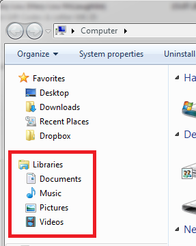
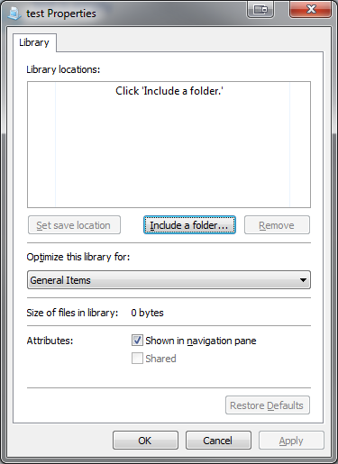
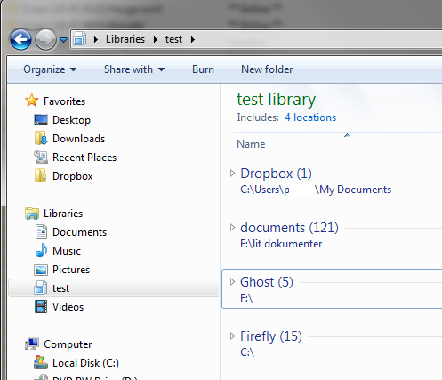

Libraries can be a nice feature to use if you have your pictures, music, movies and whatnot spread across several different locations, be that discs, servers or folders.  
It's really simple to setup too!

Open up explorer and look to your left, there you will see the default Libraries Windows has set up.

 You can use the default Libraries as a starting point, or you can create a new one by right-clicking Libraries New&#8211;>Library

Either way you still have to include some extra folders to fully enjoy the functionality of Libraries.

Right-click the Library you want to change and hit Properties. If it is a newly created Library, it will look something like this:

 Click on Include a folder and choose the folders containing whatever stuff you want to show up in your Library, and hit OK.

After you have included some folders your Library will look something like this:

 Now you can browse or search all your locations from one single starting point.
