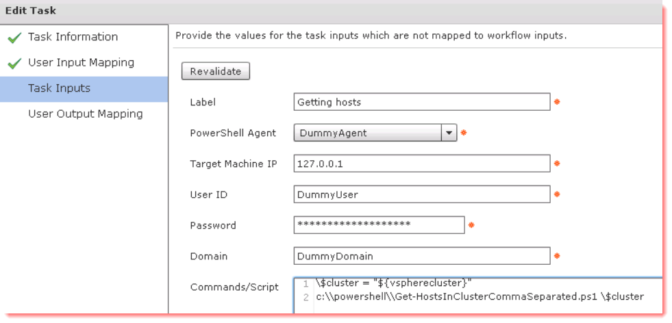
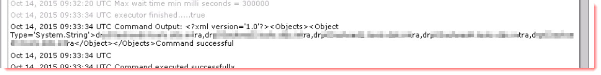
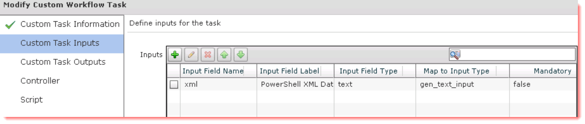
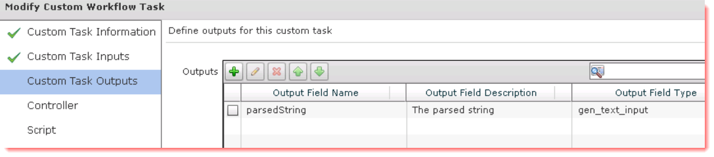
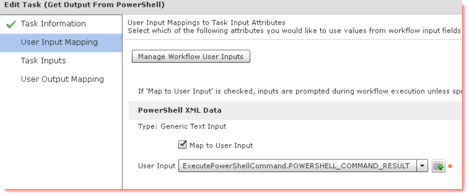
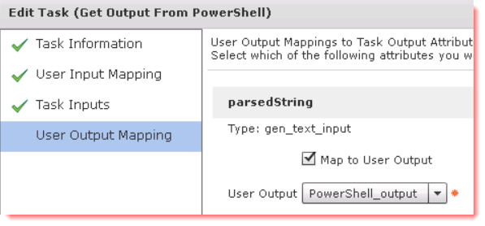
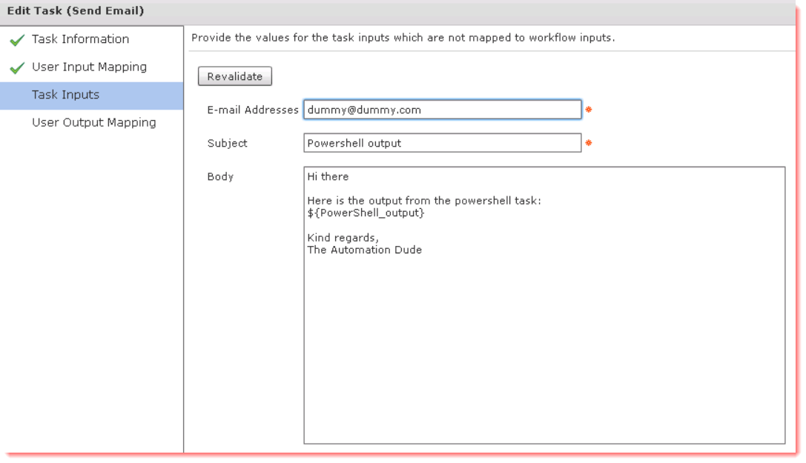

My last post described how to get around some issues with using Powershell tasks in workflows. While that post surely enables you to uilize powershell to do stuff for you, what about if you want Powershell to grab stuff for you and return them in a usable matter?  
This time I'm going to show you how you can return a string from Powershell and use it further down in the workflow. Cisco has provided an example on how to do that here: <https://communities.cisco.com/docs/DOC-58250>

The example from Cisco is what I started with, but I have modified it a bit since I didn't want anything that advanced.

So let's set the stage:  
Say you have a workflow that uses the execute powershell command task and you want that task to output something you can utilize further down  in the workflow, e.g. sending that output in an email. In this case we will use powershell to give us a comma separated list of esxi hosts in a given cluster.  
The workflow has 1 defined workflow user input, vspherecluster, and 1 defined workflow user output, PowerShell_output.

There are a few things we need to get this done:

  * A powershell script that only outputs one line with all the hosts
  * A powershell task that runs said script
  * A custom tasks that parses the powershell output and only returns the string returned by the powershell script
  * A send email task sending the output

First off, the powershell script:

 ```powershell
 Param (
 [Parameter(Mandatory=$True,Position=0)][string]$Cluster
 )
#Add the vmware snapin
Add-PSSnapin vmware*

#Connecting to vCenter
Connect-VIServer drt01srv003 -WarningAction Ignore | out-null

#Getting ESXi hosts
$vmhosts = get-vmhost -Location $cluster

#Creating a blank array to put hostnames in
$hostarray =@()

#Looping through all ESXi hosts and adding their names to the array
foreach ($vmhost in $vmhosts) {
 $hostarray += $vmhost.name
 }

#Disconnecting from vCenter
Disconnect-VIServer drt01srv003 -Confirm:$false

#Comma separaing the array and returning it to console
return $hostarray -join "," 
```

The comments should be pretty explanatory, but in essence it connects to vCenter, grabs the name of the esxi hosts in the given cluster and then returns them comma separated.  
This works fine and dandy in a powershell console, but the output from the powershell task will look rather different, we'll look at that in a second. Secondly, the powershell task kicking off the script:

[][1]

The output from this task will look something like this:[][2]

If you're unfamiliar with how UCS Director handles powershell but familiar with powershell, then that's probably not what you expected at all.

Now we need to parse that output and return only the string we want. I made a custom task for this, like in the example from Cisco:

Required inputs:  
[][3]

Outputs:  
[][4]

The beauty of doing it like this is that you can create any kind of output type just by changing the output type. I actually use this to create outputs of other types as well, for example vmwareHostNodeIdentity, vmwareClusterIdentity and so on. It's just easier for me to use powershell to put those kind of outputs together instead of using javascript since I really don't know javascript.

And then the script:

```js
importPackage(com.cloupia.lib.util);
importPackage(java.util);

var xml = input.xml;

// Try and parse the <Objects>...</Objects> section
var objects_xml = XMLUtil.getValue("Objects", xml);
logger.addDebug("Grabbed objects from xml: "+objects_xml);

// Parse the objects list now (should also be a single section):
object_list = XMLUtil.getTag("Object",objects_xml.get(0))
logger.addDebug("Grabbed object_list from xml: "+object_list);

//Convert object_list to string
list = String(object_list);
logger.addDebug("list: "+list);

// Slice off last xml characters
parsedString = list.substring(30);
logger.addDebug("After removing first characters: "+parsedString);
parsedString = parsedString.slice(0,-10);
logger.addDebug("After removing last characters: "+parsedString);

output.parsedString = parsedString; 
```

When using the custom task in a workflow I map the input to the output from the powershell task:

[][5]

And the output to the defined workflow user output:

[][6]

Lastly, it's the send email task which is pretty simple:

[][7]

If you want to test this yourself, you can download this example workflow here: [/wp-content/uploads/2015/10/getPowershellOutput.zip](/wp-content/uploads/2015/10/getPowershellOutput.zip)

 [1]: /wp-content/uploads/2015/10/2015-10-14_13-41-33.png
 [2]: /wp-content/uploads/2015/10/2015-10-14_14-02-07.png
 [3]: /wp-content/uploads/2015/10/2015-10-14_13-42-43.png
 [4]: /wp-content/uploads/2015/10/2015-10-14_13-43-04.png
 [5]: /wp-content/uploads/2015/10/2015-10-14_13-43-32.png
 [6]: /wp-content/uploads/2015/10/2015-10-14_13-43-56.png
 [7]: /wp-content/uploads/2015/10/2015-10-14_13-44-27.png